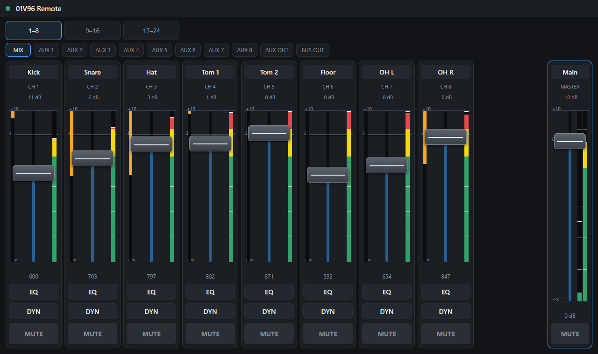
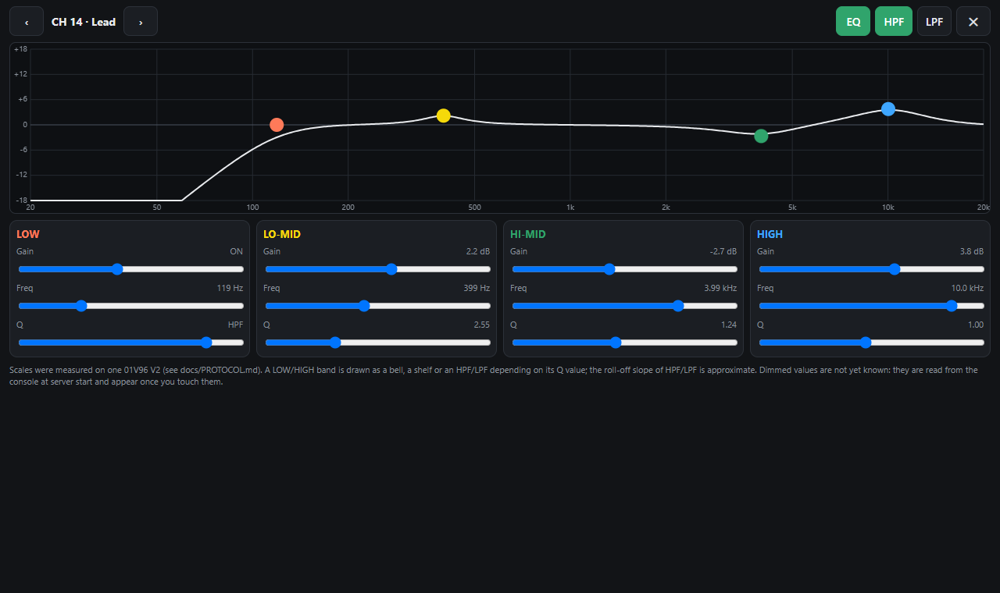
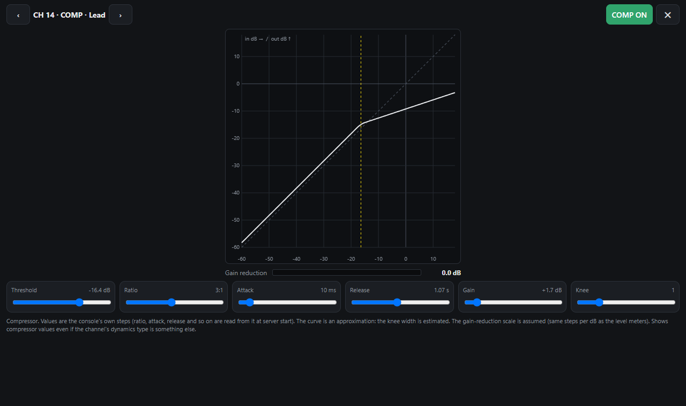
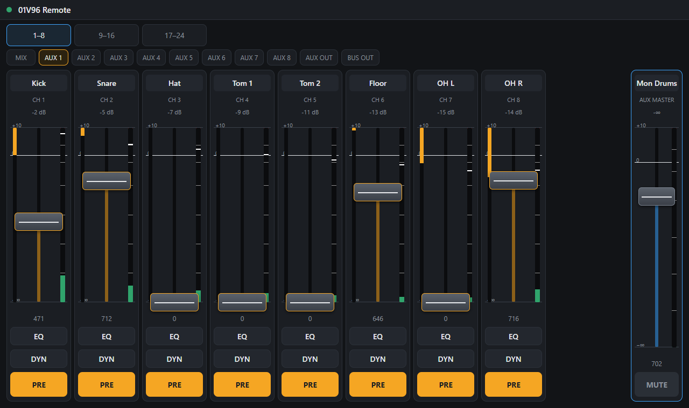
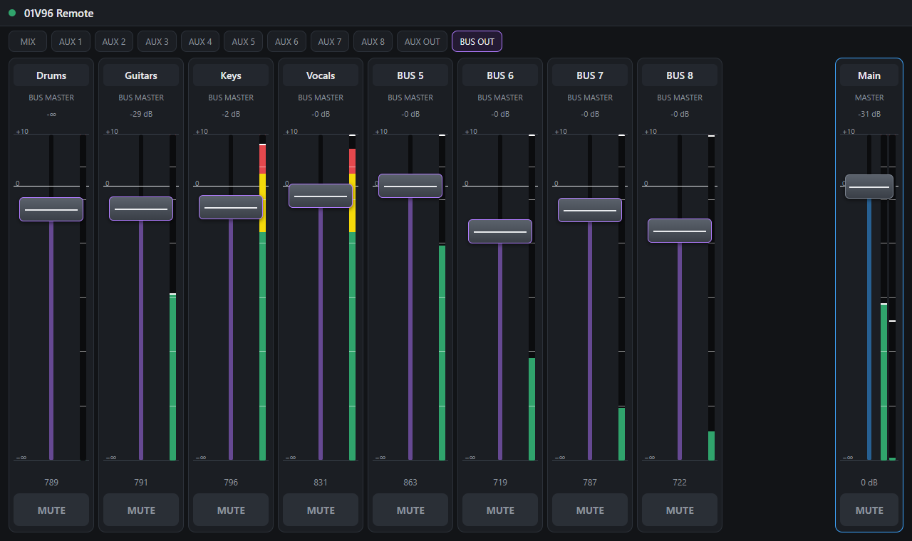

# 01V96 Web Remote

A browser-based remote control for the **Yamaha 01V96 V2** digital mixing console.
It runs on a small computer such as a **Raspberry Pi** that is connected to the console's
**USB "TO HOST"** port, and serves a touch-friendly page that you can open on a tablet, phone or laptop
on the same network.

> **Unofficial project.** It is not made, endorsed or supported by Yamaha. *Yamaha* and *01V96* are
> trademarks of Yamaha Corporation. The console has no documented remote protocol for most of what this
> project does, so much of it was found by experiment (see [docs/PROTOCOL.md](docs/PROTOCOL.md)).
> Use it at your own risk, and not for the first time in front of an audience.



| EQ | Compressor |
|---|---|
|  |  |
| **AUX sends** (the faders become one aux's sends) | **BUS masters** |
|  |  |

*The screenshots show the built-in demo mix (see below), not a real show.*

## What it does

- **Faders and mutes** for input channels 1-24, with the stereo master. Moving a control on the console moves it
  in the page, and the other way round.
- **Level meters** for the inputs, the AUX and BUS outputs and the stereo master, and **gain-reduction bars**
  for compressors.
- **EQ page:** four bands with a response graph (bell, shelf, HPF and LPF shapes), plus EQ / HPF / LPF switches.
- **Compressor page:** threshold, ratio, attack, release, gain, knee and on/off, with a transfer-curve graph
  and a gain-reduction meter.
- **AUX sends:** open an AUX tab and the channel faders become that aux's send levels, with a PRE/POST switch.
- **AUX and BUS masters** in two extra views (faders and ON buttons).
- **Monitor mixes for performers:** open `http://<pi>:8000/?aux=3` to show only aux 3's sends, so each musician
  can bookmark and control their own mix.
- **Names** you type in the page (channels, ST OUT, AUX and BUS masters), shared between all devices and
  saved on the Pi.
- **Startup read-back:** on start the server reads the console's current state, so the page does not begin empty.

## Status

This was developed against **one** 01V96 V2. It works there, but:

- Some parts are **extrapolated** from a pattern and have not been seen on hardware (for example AUX 4-8
  sends and some AUX/BUS master numbers). [docs/PROTOCOL.md](docs/PROTOCOL.md) marks what is *verified* and what is *assumed*.
- **Channel names are not written to the console.** No way to read or write them was found over MIDI, so the
  names live in the web page only.
- Input channels 25-32 and the stereo inputs are not shown (the page covers channels 1-24 by default).
- Tested with a real console **only on a Raspberry Pi (Linux)**; Windows was used for development in mock
  mode. Not tested on the original 01V96 (version 1) or on other consoles.

Reports from other consoles and firmware versions are very welcome: [docs/TESTING.md](docs/TESTING.md) is a short checklist
for owners, and [CONTRIBUTING.md](CONTRIBUTING.md) explains the rest.

## What you need

- A Yamaha 01V96 V2 (USB "TO HOST" connection)
- A computer on the same network as your tablet, e.g. a Raspberry Pi (any model with USB and a recent Python)
- A USB cable between the console and that computer
- Python 3.11 or newer

## Quick start without a console (mock mode)

This lets you try the page and develop without any hardware. Meters move with fake data. Add `DEMO=1` for a
made-up mix with names, EQ, compressors and sends already filled in (what the screenshots show); without it,
values stay empty until you touch them.

```bash
pip install -r requirements.txt
MIDI_PORT=mock DEMO=1 uvicorn server.app:app --host 0.0.0.0 --port 8000
```

On Windows PowerShell:

```powershell
$env:MIDI_PORT="mock"; $env:DEMO="1"; uvicorn server.app:app --port 8000
```

Open <http://localhost:8000>.

## Running with a real console

1. Set up the console (see below).
2. Connect it with USB and check that the computer sees a MIDI port:
   ```bash
   python -c "import mido; print(mido.get_output_names())"
   ```
3. Start the server (the default port name to look for is `01V96`):
   ```bash
   MIDI_PORT=01V96 uvicorn server.app:app --host 0.0.0.0 --port 8000
   ```
4. Open `http://<address of the Pi>:8000` on your tablet. After an update, force-reload the page
   (Ctrl+Shift+R) so the browser doesn't keep an old copy.

There is no login, so **only run it on a network you trust**.

### Console setup (MIDI / SETUP screen)

| Setting | Value |
|---|---|
| Port | USB (TO HOST) |
| Control Change | **TABLE** mode, TX **and** RX on |
| Parameter Change | TX **and** RX on |
| Rx channel | 1 (device number 0), and all MIDI channels 1-14 accepted ("omni") |
| Control change table | left at its **initial** values |

Details and the reasoning are in [docs/PROTOCOL.md](docs/PROTOCOL.md).

### Settings (environment variables)

| Variable | Default | Meaning |
|---|---|---|
| `MIDI_PORT` | `01V96` | Part of the MIDI port name to look for, or `mock` for no hardware |
| `CHANNELS` | `24` | Number of input channels shown |
| `NAMES_FILE` | `names.json` next to `server/` | Where names typed in the page are saved |
| `DEMO` | off | `1` with `MIDI_PORT=mock`: start with a made-up, fully populated mix (never saved) |
| `METER_FLOOR_DB` | `-60` | Bottom of the level-meter scale |
| `GR_STEPS_PER_DB` | `41` | Scale of the gain-reduction bars (assumed; see the protocol notes) |

## Roadmap

What is planned, and what is waiting for someone with a console to check it, is tracked in the
[issues](https://github.com/JanneSaare/01v96-web-remote/issues) and
[milestones](https://github.com/JanneSaare/01v96-web-remote/milestones). Issues labelled
`good first issue` and `help wanted` are good places to start.

## Tools for exploring the console

The [`tools/`](tools/) folder holds the scripts that were used to work out the console's protocol: scanners,
live monitors, calibration helpers. They are how new parameters are found, and how you can help check
your own console. See [docs/TOOLS.md](docs/TOOLS.md).

## Development

```bash
pip install -r requirements-dev.txt
pytest
```

The tests run without a console. See [CONTRIBUTING.md](CONTRIBUTING.md).

## Yamaha documentation

Yamaha's manuals are copyrighted and are **not** included here. The protocol notes refer to two of them:
the *01V96 Version 2 Owner's Manual* (Appendix C: MIDI data format) and the *MIDI control* tables. They are available from
the support section of Yamaha's website.

## Licence

[MIT](LICENSE) © 2026 Janne Saare
